# FlowLine Materials Planner

Open-source materials planner for the materials team of an **engineer-to-order** manufacturer: one screen that
answers the four questions a Materials Manager is asked every week.

1. **Can we build it?** Clear-to-build by customer project: shortages, late parts, the gating part and the date
   each order can actually be built and shipped.
2. **Where will inventory land?** Turns, days of inventory and the year-end working-capital landing against
   target, by stock type, with the levers (push-outs, cancellations, excess) that close the gap.
3. **Are our contract manufacturers keeping up?** Forecast sent against what they committed, their capacity,
   and delivery performance.
4. **Which suppliers put us at risk?** On-time delivery, quality, purchase price variance, single-source risk
   and dual-sourcing progress.

Around those four, it runs the department:

5. **Is supply protected?** Safety stock for repeat parts, a supply-risk register with a heat map, the dual-sourcing
   plan and logistics-provider performance.
6. **Are we taking cost out?** A savings pipeline against the annual target, plus opportunities the model finds.
7. **How is the team doing?** Department KPIs against target and a scorecard for each buyer, planner and analyst.
8. **What do we discuss this week?** Meeting agendas for engineering, production, contracts and finance, and an
   action log that carries from week to week.

Every finding lands in one **prioritized action list** with an owner, and everything exports to Excel, a PDF
review pack, a meeting pack, and a Power Query-ready workbook.

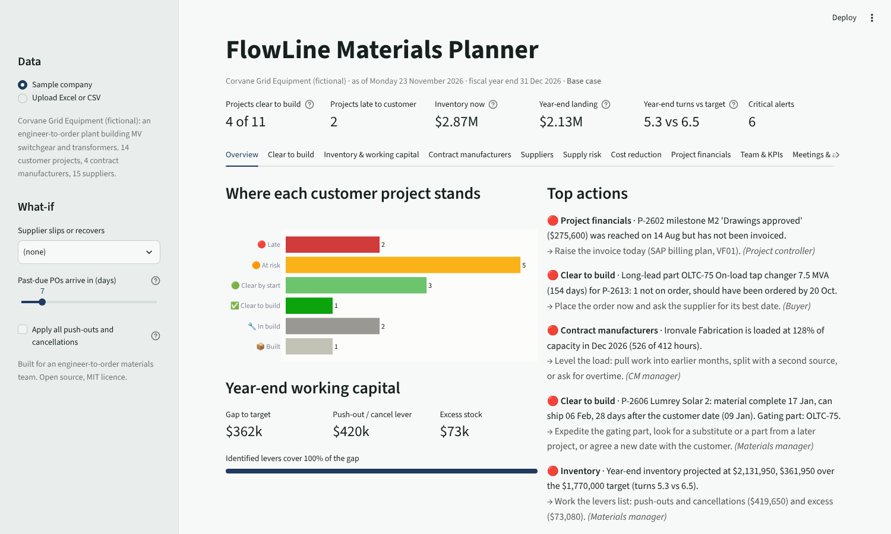

The sample data is **Corvane Grid Equipment**, a fictional plant that builds medium-voltage switchgear lineups
and pad-mount / substation transformers with in-house assembly and four contract manufacturers. All company,
customer and supplier names are invented.

## What it does

| Area | What you get |
| --- | --- |
| Clear to build | Multi-level BOM explosion per project; sub-assembly stock netted first; stock and open POs allocated in build-start order; pegged (project) POs respected; status Clear to build / Clear by start / At risk / Late; material-ready date, gating part, can-ship date and float; drill-down tree per project |
| Late and long-lead parts | Every late or uncovered line with supplier and buyer; long-lead parts with order-by dates (overdue, order now) |
| PO exception messages | Expedite, push out, cancel, reduce and past-due messages per PO line, like SAP MD06 exception messages, with the year-end inventory effect of each |
| Inventory and working capital | Inventory now by stock type (raw, semi-finished, WIP, finished goods); turns and days of inventory; month-by-month projection driven by the material plan; year-end landing vs target; a bridge from landing to target |
| Contract manufacturers | Forecast sent vs committed vs today's demand, in capacity hours, by month; load against CM capacity; commitment inside the commit window; stale-forecast warning; OTD and quality |
| Supplier scorecard | OTD with a configurable window, early deliveries, quality ppm, PPV, spend, open and late lines, score and grade |
| Sourcing risk | Approved sources per part; single-source risk score (lead time, spend, projects exposed, shortages); dual-sourcing status and target date |
| What-if | A supplier slips or recovers N days; past-due POs arrive later; apply all push-outs and cancellations. Everything recalculates |
| Supply risk | Safety-stock recommendation for repeat parts from demand and delivery variability; risk register (entered + detected) with a 5 x 5 heat map; dual-sourcing plan; logistics-provider OTD, cost and premium freight |
| Cost reduction | Savings projects by stage, weighted pipeline, realized vs target and vs expected-by-now; opportunities found from PPV, cheaper quotes, premium freight and carrying cost |
| Team and KPIs | Department KPIs vs target with 12-month trends; scorecards per buyer (their parts and suppliers), planner (their product family) and inventory analyst; alerts routed to the right person |
| Project financials | Contract, budget, actual, committed and estimate to complete per project and cost element; EAC and margin fade; cost-to-cost revenue, unbilled and billings in excess; billing milestones that move with the material plan (build start, shipment, drawing approval); invoices not raised; receivables aging and DSO; fiscal-year billing at risk; change orders and submittals; project review PDF |
| Value stream | Value stream map for one product family: process boxes with C/T, C/O, uptime, operators and load vs takt; stock triangles in days and dollars from the app's inventory; information flow; timeline with waiting vs process days, lead time and value-added %; biggest wait flagged; future state with stock-day and changeover targets, lead-time change and working capital freed; shown as an animated isometric plant (each step an illustrated building on its own tile, stock as piles of crates, lineups flowing through) that also downloads as one offline HTML file |
| Meetings and actions | Weekly agenda per stakeholder (production, engineering, contracts, finance, suppliers and CMs, team); meeting pack PDF and text; editable action log with overdue flags; alerts added to the log in one click |
| Alerts | One list across all areas: severity, due date, message, suggested action, owner, person, value |
| Exports | Formatted Excel report; 7-page PDF review pack; meeting pack PDF; project review PDF; Power Query workbook (every output as a named Excel Table); input workbook; alerts and action-log CSV |

## Quick start

**Windows:** put the folder anywhere (for example `D:\Project\flowline-materials-planner`), double-click
`install_windows.bat` once, then `run_planner.bat` whenever you want to use it.

**Any system**, with Python 3.10 or newer:

```bash
git clone https://github.com/alphakfli/flowline-materials-planner.git
cd flowline-materials-planner
python -m venv .venv
source .venv/bin/activate          # Windows: .venv\Scripts\activate
pip install -e ".[dev]"
streamlit run app/streamlit_app.py
```

The dashboard opens with the sample company. Switch to **Upload Excel or CSV** in the sidebar to use your own data.
The [user guide](docs/user-guide.md) walks through the app step by step with twelve scenarios.

### Put it online: Streamlit Community Cloud

1. Push the repository to GitHub (`push_to_github.bat` on Windows).
2. Sign in at [share.streamlit.io](https://share.streamlit.io) with GitHub and choose **Create app**.
3. Pick the repository, branch `main`, main file `app/streamlit_app.py`. It installs `app/requirements.txt`.

Free apps sleep after a period without visitors; open the link once before a demo to wake it.

### Command line

```bash
flowline sample samples/                     # sample data as .xlsx and CSV
flowline template my_input.xlsx              # blank input template with every column explained
flowline run my_input.xlsx --out output/     # run and write the Excel, PDF and Power Query outputs
flowline run samples/csv                     # a folder of CSVs works too
```

### Python

```python
from flowline import build_sample, run, Scenario
from flowline.reports import excel_report, pdf_report

r = run(build_sample(), Scenario(supplier_delay={"S100": 21}))
print(r.summary())
r.ctb.projects[["project_id", "ctb_status", "material_ready", "gating_item"]]
open("review.pdf", "wb").write(pdf_report(r))
```

## Screens

| Clear to build | Inventory and working capital |
| --- | --- |
| 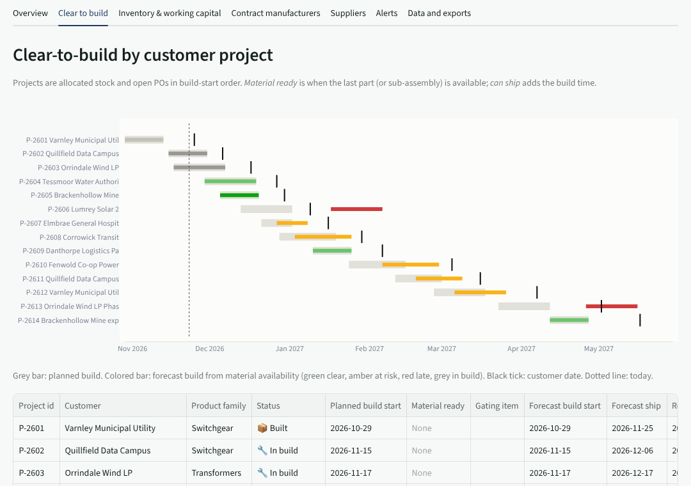 | 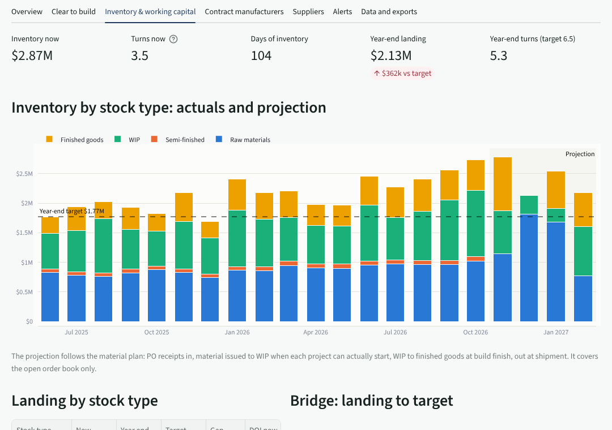 |
| **Contract manufacturers** | **Suppliers** |
| 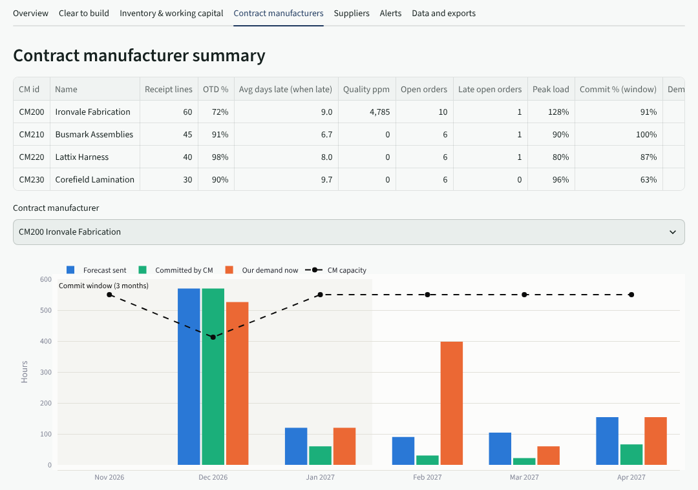 | 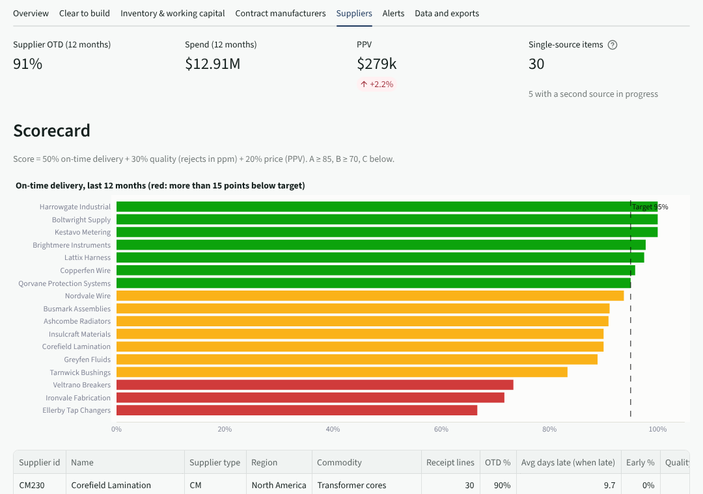 |
| **Supply risk** | **Cost reduction** |
| 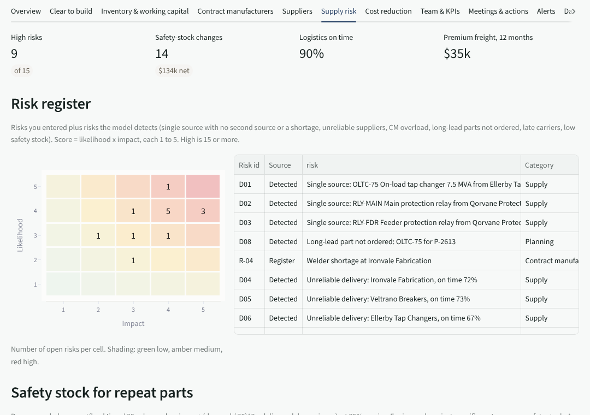 | 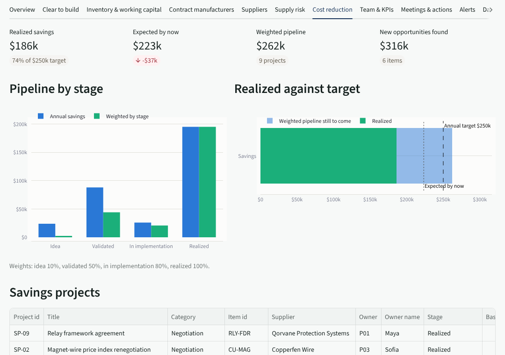 |
| **Team & KPIs** | **Meetings & actions** |
| 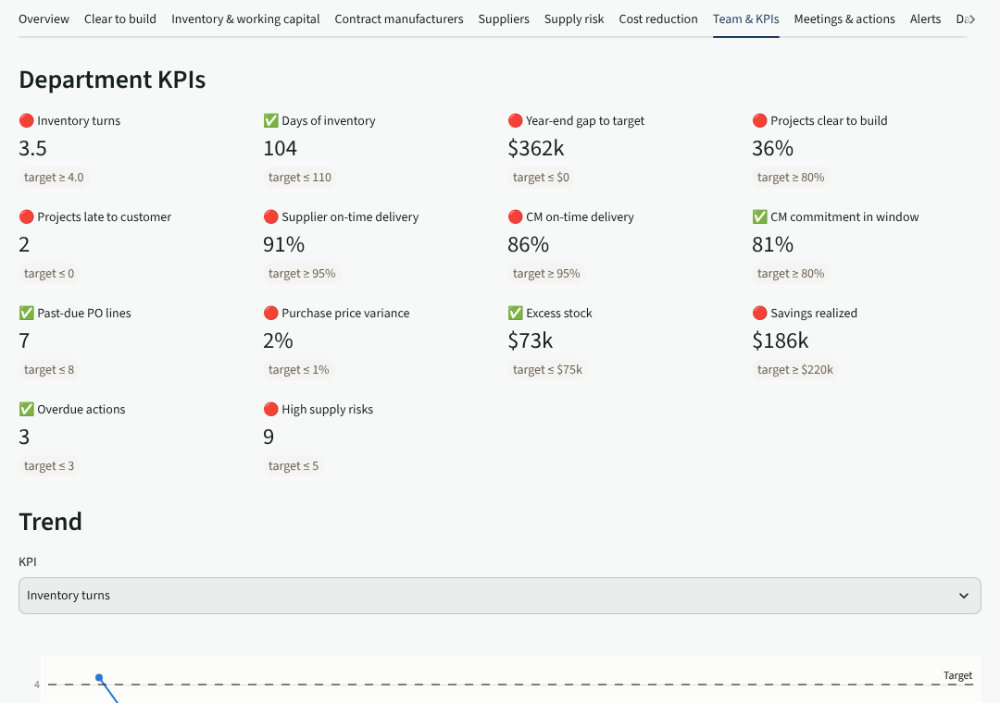 | 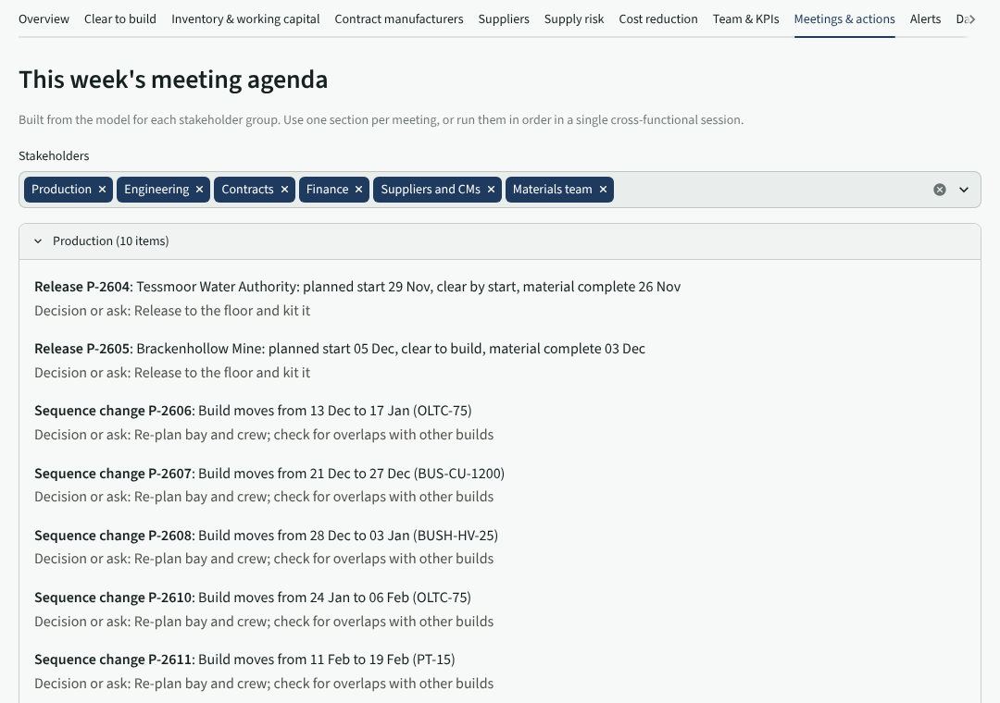 |
| **Project financials** | **Value stream** |
| 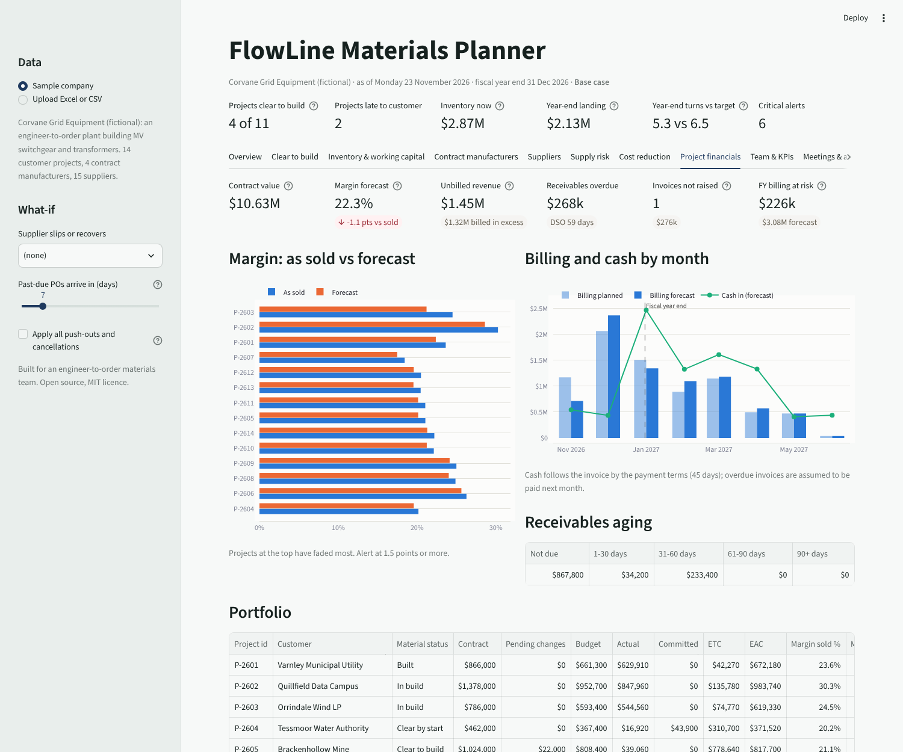 | 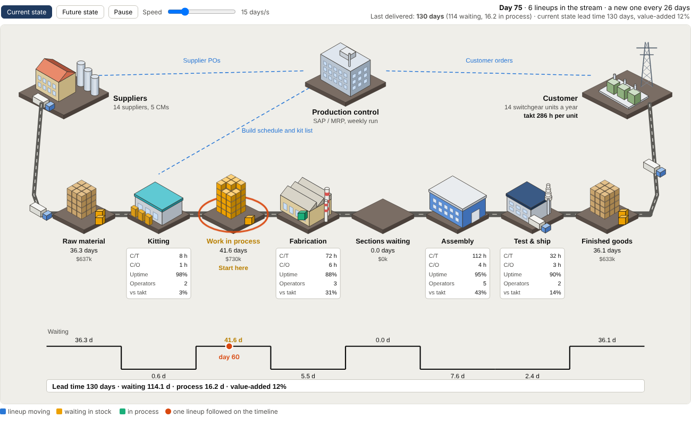 |

## Input data

One workbook with a sheet per table, or one CSV per table. Only `items`, `bom` and `projects` are required; each
optional table switches on more of the dashboard.

| Table | What it holds | Typical SAP source |
| --- | --- | --- |
| items | Parts, sub-assemblies and project top items; cost, lead time, supplier, stock | MARA / MARC / MBEW / MARD |
| bom | Multi-level BOM | STKO / STPO (CS12) |
| projects | Customer orders with build start, build days and customer date | Sales orders / PS (VBAK / VBAP) |
| purchase_orders | Open PO and CM order lines with promised dates and optional project peg | EKKO / EKPO / EKET (ME2M) |
| receipts | Goods receipts, last 12 months | EKBE / MSEG (ME80FN) |
| suppliers, item_sources | Supplier master and source list | LFA1, EORD / EINA |
| cm_forecast, cm_capacity | Forecast sent to each CM, their commitment and capacity | Your CM collaboration file |
| inventory_history, inventory_targets | Month-end inventory by stock type, COGS, year-end targets | Finance month-end pack (MC.9, MB5B) |
| team, objectives, kpi_history | People and their scope, KPI targets, KPI history | HR / your scorecard file |
| actions | The weekly action log | Kept by the app (download, re-upload) |
| consumption_history | Monthly usage of repeat parts | MSEG goods issues (MB51), MCBE / MC.9 |
| wbs_budget, cost_actuals, change_orders, billing_milestones, submittals | Project budget and cost by element, change orders, billing plan and invoices, submittals | PS (CJ30, CJI3), sales-order billing plan (FPLA / FPLT), VF03, FBL5N |
| process_steps | One product family's route: process steps (C/T, C/O, uptime, operators) and stock points, with targets | Routing (CA03), work centres (CR03) |
| risk_register, shipments, savings_projects | Your risks, inbound shipments, savings projects | Risk log, freight invoices / TMS, savings tracker |
| settings | As-of date, fiscal year end, turns target, on-time window and other rules | – |

See [docs/data-format.md](docs/data-format.md) for every column and [docs/sap-mapping.md](docs/sap-mapping.md)
for how to pull each table out of SAP.

## How it works

The logic is written up in [docs/logic.md](docs/logic.md). In short: projects are exploded through their BOM and
allocated stock and open POs in build-start order, the way a planner works a missing-parts list; the material-ready
date drives the forecast build, which drives the inventory projection (receipts in, issues to WIP at the real
build start, WIP to finished goods, out at shipment). So a late part shows up three times: as a late project, as
raw material sitting in stock longer, and as a billing milestone (and its cash) moving out.

## Project layout

```
app/streamlit_app.py        dashboard
src/flowline/
  models.py                 tables, schema, settings
  ctb.py                    clear-to-build allocation, PO exceptions, excess, long-lead
  inventory.py              projection, turns, DOI, year-end landing, levers
  suppliers.py              supplier scorecard, sourcing risk, CM view
  risk.py                   safety stock, risk register, dual-sourcing plan, logistics
  cost.py                   savings pipeline and cost opportunities
  team.py                   department KPIs and team scorecards
  meetings.py               stakeholder agendas and the action log
  alerts.py                 prioritized action list
  engine.py                 run everything, what-if scenarios
  sample.py                 the fictional sample company
  io/                       Excel / CSV import, template
  reports/                  Excel, Power Query and PDF exports
scripts/check_sensitive.py  scan for secrets and personal data before publishing
tests/                      pytest
docs/                       user guide, logic, data format, SAP mapping
```

## Development

```bash
pip install -e ".[dev]"
pytest -q
ruff check src app tests scripts
python scripts/check_sensitive.py
```

CI runs the sensitive-data check, lint and tests on every push.

## Licence


MIT. See [LICENSE](LICENSE).
